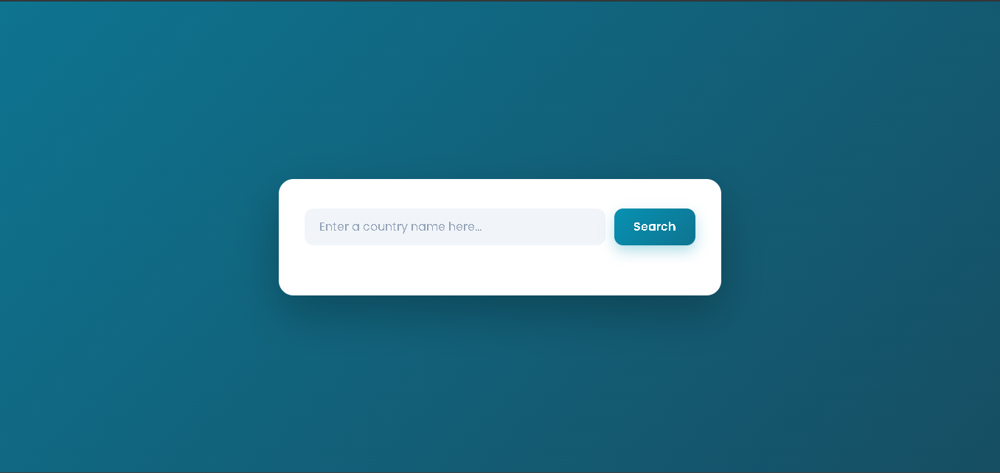
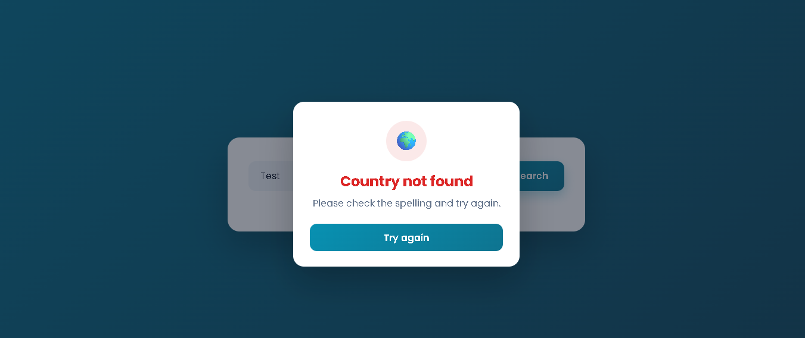

# Country Search

A small search app that shows information about any country. Type a country name, press **Search** or the Enter key, and see its flag, capital, continent, population, currency, and languages. The data comes live from the REST Countries API.

## Screenshots

### Search screen


### Country not found popup



## Features

- Search by country name with the button or the Enter key
- Shows the flag, capital, continent, population, currency, and common languages
- Friendly popup for an empty search or a country that isn't found
- Loading message while the data is fetched
- Handles countries with missing data (for example, no capital or currency) without crashing
- Responsive layout for phones and desktops

## How to Run

1. Clone the repository:
   ```bash
   git clone https://github.com/abdallaahemd/Country-Search.git
   ```
2. Open the project folder.
3. Open `index.html` in your browser. An internet connection is needed to load the data.

## Project Structure

```
Country-Search/
├── index.html      # Page layout and search form
├── style.css       # Styles
├── main.js         # API requests, result display, and popup
└── screenshots/    # Screenshots used in this README
```

## API

This project uses the free [REST Countries API](https://restcountries.com/):

```
https://restcountries.com/v3.1/name/{country}?fullText=true
```

## What I Learned

- Fetching data from an API with `fetch()` and `async` / `await`
- Handling errors with `try` / `catch` and checking `response.ok`
- Reading nested JSON data (arrays and objects)
- Using optional chaining (`?.`) and nullish coalescing (`??`) to avoid crashes on missing data
- Building a responsive grid layout with CSS Grid

## Built With

- HTML
- CSS
- JavaScript
- REST Countries API

## Author

**Abdallah Ahmed**: Programming instructor and developer
- LinkedIn: https://www.linkedin.com/in/abdalla-konsowa-386414203
- itch.io: https://abdallak.itch.io/
